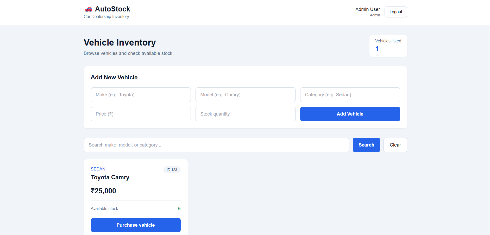

\# Car Dealership Inventory System


A full-stack car dealership inventory management application built with React, TypeScript, Node.js, Express, and SQLite. The system supports user authentication, vehicle inventory management, vehicle search, purchasing, and role-based administrative operations.


\## Features


\### Authentication and Authorization

\- User registration and login.

\- Password hashing using bcrypt.

\- JWT-based authentication.

\- Role-based access control for regular users and administrators.

\- Protected vehicle management endpoints.


\### Vehicle Inventory

\- Add new vehicles.

\- View available vehicles.

\- Search and filter vehicles.

\- Update vehicle details.

\- Purchase vehicles with inventory quantity updates.

\- Delete vehicles with administrator authorization.

\- Restock vehicle inventory with administrator authorization.


\### Frontend

\- React and TypeScript.

\- Tailwind CSS styling.

\- Login and registration interfaces.

\- Inventory dashboard.

\- Vehicle search and management controls.

\- Administrative controls based on user role.


\### Testing

\- Backend tests using Vitest and Supertest.

\- TypeScript compilation checks.

\- Frontend production build verification.


\## Technology Stack


| Component | Technologies |

|---|---|

| Frontend | React, TypeScript, Vite |

| Styling | Tailwind CSS |

| Backend | Node.js, Express, TypeScript |

| Database | SQLite using better-sqlite3 |

| Authentication | JSON Web Tokens (JWT), bcrypt |

| Testing | Vitest, Supertest |


\## Prerequisites


Install the following before running the application:


\- Node.js and npm.

\- Git.

\- A terminal such as PowerShell.


\## Project Structure


```text

car-dealership/

├── backend/

│   ├── src/

│   │   ├── auth/

│   │   │   ├── authMiddleware.ts

│   │   │   └── authRoutes.ts

│   │   ├── app.ts

│   │   ├── database.ts

│   │   ├── makeAdmin.ts

│   │   └── server.ts

│   ├── tests/

│   │   └── app.test.ts

│   ├── package.json

│   └── tsconfig.json

├── frontend/

│   ├── src/

│   │   ├── App.tsx

│   │   ├── App.css

│   │   ├── index.css

│   │   └── main.tsx

│   ├── package.json

│   └── vite.config.ts

├── .gitignore

├── README.md

└── PROMPTS.md

```


\## Installation and Setup


Clone the repository:


```bash

git clone https://github.com/neel5892/car-dealership-inventory-system.git

cd car-dealership-inventory-system

```


\### 1. Configure the Backend


Open a terminal in the project root and run:


```bash

cd backend

npm install

```


Create a `.env` file inside the `backend` directory:


```env

JWT\_SECRET=replace-with-a-long-random-secret

PORT=3000

```


Use a strong, private JWT secret. Never commit your `.env` file or publish the secret.


\### 2. Start the Backend


From the `backend` directory, run:


```bash

npx tsx watch src/server.ts

```


The backend should be available at:


`http://localhost:3000`


Keep this terminal running.


\### 3. Configure and Start the Frontend


Open a second terminal in the project root:


```bash

cd frontend

npm install

npm run dev

```


Open the local URL displayed by Vite in the terminal. The development server may choose a port such as `5173` or `5174`, depending on availability.


\## Running Tests


From the project root, open a terminal and run:


```bash

cd backend

npx vitest run

```


The backend test suite passed \*\*21 tests\*\* during development.


To check backend TypeScript compilation:


```bash

npx tsc --noEmit

```


To check the frontend TypeScript compilation and production build:


```bash

cd ../frontend

npm run build

```


Both TypeScript checks and the frontend production build passed during development.


\## Administrator Setup


Register an account through the application first. To grant administrator access, open a backend terminal and run the following command, replacing the email with your registered account's email address:


```bash

npx tsx src/makeAdmin.ts your-email@example.com

```


Log in again to obtain a token reflecting the updated role.


\*\*Security note:\*\* Administrator promotion should be restricted to trusted operators. Do not expose the promotion script as a public API endpoint.


\## API Overview


The API uses the `/api` prefix.


| Method | Endpoint | Purpose |

|---|---|---|

| POST | `/api/auth/register` | Register an account |

| POST | `/api/auth/login` | Authenticate an account |

| GET | `/api/vehicles` | List vehicles |

| POST | `/api/vehicles` | Add a vehicle |

| GET | `/api/vehicles/search` | Search vehicles |

| PUT | `/api/vehicles/:id` | Update a vehicle |

| DELETE | `/api/vehicles/:id` | Delete a vehicle (admin only) |

| POST | `/api/vehicles/:id/purchase` | Purchase a vehicle |

| POST | `/api/vehicles/:id/restock` | Restock inventory (admin only) |


Vehicle endpoints require authentication. Send the JWT in the request header:


```http

Authorization: Bearer YOUR\_JWT\_TOKEN

```


Consult `backend/src/app.ts` and `backend/src/auth/authRoutes.ts` for the implemented request validation and response formats.


\## Security and Configuration


\- Keep environment secrets outside version control.

\- Passwords are hashed rather than stored as plaintext.

\- Vehicle endpoints are protected by JWT authentication.

\- Administrative operations require an administrator role.

\- Use HTTPS and secure deployment configuration before exposing the application publicly.

\- Configure CORS appropriately for the frontend's deployed origin.


## My AI Usage

### AI Tool Used
- **ChatGPT (OpenAI):** Used as an AI development assistant throughout this project.

### How I Used AI
I used ChatGPT for backend implementation, JWT authentication, role-based authorization, React and Tailwind CSS development, TypeScript debugging, automated test development, Git and GitHub workflows, and project documentation.

### Verification and Responsibility
I ran the backend TypeScript check, executed the backend test suite, and built the frontend for production. The latest recorded backend test run passed all 21 tests, and the frontend production build completed successfully.

I reviewed AI suggestions, ran commands, investigated errors, and tested the application. AI assistance did not replace my responsibility for validating the implementation and understanding the code.

### Reflection
AI helped me work through errors more efficiently and understand how the backend, database, authentication, and frontend fit together. I learned that AI-generated code must be tested carefully: successful compilation does not guarantee correct functionality, and passing tests do not prove complete test coverage. I am responsible for understanding and explaining the submitted code during an interview.


\## Current Verification Status


\- Backend TypeScript check: passed.

\- Backend tests: 21 passed.

\- Frontend production build: passed.

\- GitHub repository: \[car-dealership-inventory-system](https://github.com/neel5892/car-dealership-inventory-system).


These are local development verification results; they do not imply that the application has been deployed to production.


\## License


No license has been specified yet.


## Screenshots

### Admin Dashboard

The application dashboard showing the vehicle inventory and administrator interface.


